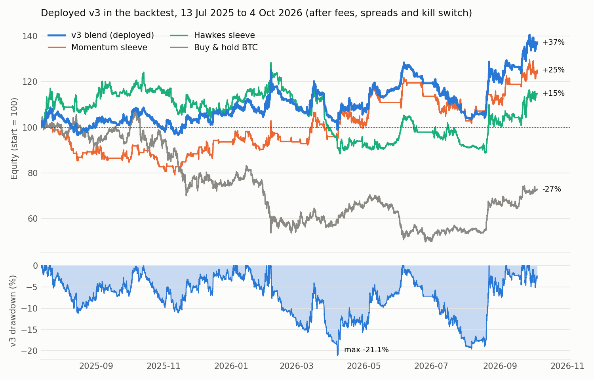
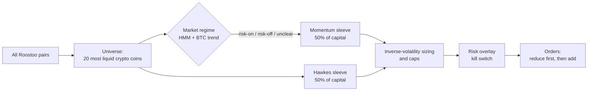

# TheONE: an autonomous long/short crypto bot for the Roostoo Quant Trading Hackathon

TheONE trades the Roostoo mock exchange on its own, 24/7, from an AWS EC2 instance. It splits its capital between two independent ideas:

1. **Regime-gated momentum.** Hold the strongest coins when the market is healthy, short the weakest when it is falling, and sit in cash when the picture is unclear.
2. **Hawkes volatility breakouts.** Treat volatility as a self-exciting process. When a quiet coin suddenly wakes up, trade in the direction it breaks.

The deployed strategy is called **v3**. It has traded the competition account since 5 October 2026. Every order comes from the bot, and nothing is placed by hand.



| Backtest of the deployed code, 13 Jul 2025 to 4 Oct 2026 | v3 | Buy & hold BTC |
|---|---|---|
| Total return | **+37.3%** | −27.2% |
| Max drawdown | **−21.1%** | −53.7% |
| Sharpe / Sortino / Calmar | 1.09 / 1.58 / 1.40 | −0.41 / −0.58 / −0.42 |
| Competition composite (0.4·Sortino + 0.3·Sharpe + 0.3·Calmar) | **1.38** | −0.48 |
| Average 10-day return (median) | +0.73% (+0.40%) | −0.51% (−0.38%) |
| Trading costs (fees + spread) over 15 months | 28.7% of starting capital | 0% |

All results are after fees, measured spreads and the kill switch, with execution at the next bar's open. The method is described in [section 9](#9-backtesting-method).

---

## Contents

1. [How the portfolio is curated](#1-how-the-portfolio-is-curated)
2. [How we arrived at this strategy](#2-how-we-arrived-at-this-strategy)
3. [The market regime filter](#3-the-market-regime-filter)
4. [Sleeve 1: regime-gated momentum](#4-sleeve-1-regime-gated-momentum)
5. [Sleeve 2: Hawkes volatility breakout](#5-sleeve-2-hawkes-volatility-breakout)
6. [Why a 50/50 blend](#6-why-a-5050-blend)
7. [Transaction costs: maker vs taker](#7-transaction-costs-maker-vs-taker)
8. [Risk management](#8-risk-management)
9. [Backtesting method](#9-backtesting-method)
10. [Results](#10-results)
11. [What we tried and rejected](#11-what-we-tried-and-rejected)
12. [How the code reflects the idea](#12-how-the-code-reflects-the-idea)
13. [Execution safety and API usage](#13-execution-safety-and-api-usage)
14. [Competition rules](#14-competition-rules)
15. [Tests](#15-tests)
16. [Running and reproducing](#16-running-and-reproducing)
17. [Limitations](#17-limitations)

---

## 1. How the portfolio is curated

Every hour, when a bar closes, the bot rebuilds its target portfolio in six steps:



| Step | What happens | Where in the code |
|---|---|---|
| **1. Universe** | Start from all Roostoo pairs. Drop tokenized stocks, PAXG, and coins without a Binance price source. Keep the **20 coins with the highest trailing 30-day median daily volume**, using only days that have ended. A coin also needs at least 60 days of history. The list updates daily. | `strategy.liquid_universe` |
| **2. Regime** | A 2-state hidden Markov model on BTC daily returns, plus BTC against its 20-day average. Both must agree before the momentum sleeve takes a side. | `regime.py`, `strategy.btc_regime` |
| **3. Momentum sleeve (50%)** | Once a day at 00:00 UTC. Risk-on: long the 2 coins with the best 14-day return. Risk-off: short the 2 worst. Unclear: cash. | `strategy.momentum_long_short` |
| **4. Hawkes sleeve (50%)** | Every hour, per coin. Long or short a coin whose volatility breaks out of a quiet spell, in the direction of the breakout. | `strategy.hawkes_volatility`, `hawkes_signal`, `hawkes_long_short` |
| **5. Sizing** | Inside each sleeve, calmer coins get more capital. A coin is capped at 20% of equity per sleeve (40% if both sleeves agree), gross exposure at 100%, and there is never leverage. | `strategy.size_inverse_vol`, `size_long_short`, `v3_blend` |
| **6. Risk and execution** | A 12% drawdown kill switch, a 5-point rebalance band, a per-pair daily order limit, and cash checks. Orders that reduce exposure go first. | `risk.py`, `execution.plan_orders`, `cap_buys_to_cash` |

The whole pipeline is one function, `strategy.v3_weights(...)`. The live bot and the backtester both call it, so they can't drift apart.

### What a typical book looks like

- **Calm or unclear markets:** mostly cash, plus one or two Hawkes positions.
- **Clear uptrends:** two momentum longs plus whatever Hawkes holds.
- **Clear downtrends:** two momentum shorts.

Average gross exposure is well below 100%. Over the 17-month test period the regime was clearly risk-on 23% of the time and clearly risk-off 13% of the time. The rest of the time the momentum sleeve holds cash.

---

## 2. How we arrived at this strategy

We started from the data, not from a favourite indicator. We analysed two years of hourly Binance data for all 66 crypto pairs on Roostoo, keeping the last three months untouched for validation (`research/analyze.py`, [docs/strategy_draft.md §2](docs/strategy_draft.md)).

| What the data said | What we concluded |
|---|---|
| The last year was a bear market: BTC −30%, most altcoins −50% to −90% | Long-only buy and hold loses. Cash, and possibly shorts, must be part of the plan. |
| Hourly returns are noise: autocorrelation ≈ 0, no hour-of-day effect with \|t\| > 2.1 in 24 tests | Don't pay a 0.2% round trip for intraday timing. Trade slowly. |
| Short-horizon returns (6h, 72h) slightly *reverse* | Avoid short lookbacks. |
| Cross-sectional momentum over 14 days was the strongest signal: the top-3 coins beat the universe by +0.45%/day gross | A momentum core, but it is fragile and tail-driven, so it needs a filter. |
| A BTC trend filter cut momentum's max drawdown from −69% to −46% | Gate momentum on the market regime. |
| Average pairwise hourly correlation is 0.49 | Holding many coins doesn't diversify much. In a crash, everything falls together. |

From there the strategy evolved in steps. Each step was kept only if it beat the previous one out of sample.

| Version | Change | Out-of-sample result |
|---|---|---|
| **v1** | Long-only 14-day momentum on 6 major coins, BTC > 20-day average gate | +4.8%, −18.8% max DD (17 months, walk-forward) |
| v1 + HMM | Add a hidden Markov model regime gate (an idea from our research note) | +6.2%, −15.8% |
| **v2** | Require the HMM **and** the BTC trend to agree | +7.2%, **−9.6%** (drawdown halved) |
| v2 long/short, top 20 | Add Roostoo shorts behind the same gate, on the 20 most liquid coins | +18.4%, −11.7%, composite 1.09 |
| **v3** | Blend 50/50 with the Hawkes sleeve | +16.2%, −12.2%, composite 1.13 at base risk |
| **v3, deployed risk** | Double the exposure (vol target 25% → 50%, gross cap 50% → 100%) and widen the kill switch 8% → 12% | **+37.3%, −21.1%, composite 1.38** |

The last step was a deliberate choice for a competition ranked first by return. It roughly doubled both return and drawdown, and its composite score is about the same.

---

## 3. The market regime filter

**The idea:** momentum works when the market trends and fails when it chops. So the strategy should only take a directional bet when the market has a clear direction, and two independent views of "direction" should agree before it does.

**View 1: hidden Markov model (HMM).** BTC daily log returns are modelled as a 2-state Gaussian HMM. One state is calm with positive drift; the other is turbulent.

- **Fit:** Baum–Welch (EM), written in numpy, on all daily returns strictly before the refit day. It is refit every 30 days on a fixed calendar, so the live bot and the backtest refit on the same days.
- **Causal:** only forward-filtered probabilities are used. P(bull) for day *d* uses returns up to day *d* and is traded on day *d+1*.
- **Labels:** "bull" is the state with the higher mean/volatility ratio, because state labels can swap between fits.
- **Ensemble:** we found that the refit date alone changed the momentum sleeve's return from +8.6% to +26.1%. To remove that luck, the bot averages P(bull) over **6 refit calendars**, offset by 0, 5, 10, 15, 20 and 25 days.

**View 2: BTC trend.** BTC's close against its 480-hour (20-day) simple moving average.

| | BTC above its 20-day average | BTC below its 20-day average |
|---|---|---|
| **P(bull) > 0.5** | **Risk-on:** momentum goes long | Unclear: momentum in cash |
| **P(bull) < 0.5** | Unclear: momentum in cash | **Risk-off:** momentum goes short |

Requiring both views roughly halved the max drawdown compared with either alone (−9.6% vs −15.8% and −18.8%). We fixed the threshold at 0.5 before testing. Tighter thresholds looked better on the same data, but choosing one would have meant tuning on the test set.

Code: `regime.fit`, `regime.filter_probs`, `regime.bull_probability_ensemble`, plus `regime.latest_bull_probability`, a fast path for the live bot that is unit-tested to match the full computation.

---

## 4. Sleeve 1: regime-gated momentum

**The idea:** in crypto, coins that outperformed over the last two weeks tend to keep outperforming for a while, and in a falling market the weakest coins keep falling. The edge is concentrated in the very top and bottom names, so the sleeve holds few coins.

**Rules (once a day, at the 00:00 UTC bar close):**

```math
\text{score}_i = \frac{P_{i,t}}{P_{i,t-336h}} - 1 \qquad \text{(14-day return, eligible coins only)}
```

- **Risk-on:** long the 2 coins with the highest score, if their score is positive.
- **Risk-off:** short the 2 coins with the lowest score, if their score is negative.
- **Otherwise:** cash.
- Weights are held until the next 00:00 UTC rebalance (`strategy.hold_until_rebalance`), so the sleeve trades about once a day.

**Why 2 coins, 14 days and a daily rebalance:**
- With 5, 10 or 15 coins the in-sample composite fell from 0.99 to between 0.11 and 0.78. Extra names add weak signals and fees.
- Faster versions (7-day momentum rebalanced every 12h, 3-day every 4h) earned less at every risk level, because fees grew faster than the edge.
- 14 days and 20 days were picked from a handful of round values up front, not optimised. Re-tuning them by particle swarm optimisation each fold made results *worse* (−3.4% vs +4.8%).

Code: `strategy.momentum_long_short`.

---

## 5. Sleeve 2: Hawkes volatility breakout

### Where the idea comes from

This sleeve started at the **Inter IIT Tech Meet**, where our team lead Falgun took part. There the team kept coming back to one question: how do you tell a real breakout from ordinary noise?

The answer was to model volatility as a **self-exciting process**. In markets, a big move makes more big moves likely in the next hours (volatility clusters), and that effect fades over time. A **Hawkes process** describes exactly this: every event raises the intensity of future events, and the boost decays exponentially.

The original research code, which we called `lunar_phase_strategy`, built a Hawkes volatility signal and tuned its five parameters with particle swarm optimisation (PSO). For this hackathon we rebuilt it from scratch, removed lookahead, added shorts, moved it onto the shared engine and validated it walk-forward.

### The intuition

Volatility is either asleep or awake. When a coin has been unusually quiet and its volatility suddenly jumps into its top 1%, new information or new flow has arrived. The direction the price has moved since the quiet point tells us which side that flow is on. We follow it until the coin goes quiet again.

### The maths (all in log prices, hourly bars)

**1. Normalised range.** Each hour's high–low range is divided by the average true range, so coins of any volatility are comparable:

```math
TR_t = \max\big(h_t - l_t,\ |h_t - c_{t-1}|,\ |l_t - c_{t-1}|\big), \qquad
ATR_t = \mathrm{EMA}_{1/244}(TR)_t, \qquad
x_t = \frac{h_t - l_t}{ATR_t}
```

**2. Hawkes intensity with an exponential kernel.** Each bar's range is an "event" whose effect decays at rate κ per hour:

```math
\lambda_t = e^{-\kappa}\,\lambda_{t-1} + x_t, \qquad v_t = \kappa\,\lambda_t
```

With κ = 0.016, an event's effect halves in ln 2 / κ ≈ 43 hours.

**3. Adaptive thresholds.** Rolling 479-hour quantiles of *v*: a *quiet* level q₀.₀₁ and a *breakout* level q₀.₉₉.

**4. Signal, per coin:**
- **Quiet:** when *v* falls below q₀.₀₁, remember that time τ and go flat.
- **Breakout:** when *v* crosses above q₀.₉₉ after a quiet point, go **long** if the close is above the close at τ, otherwise **short**.
- **Hold** until the next quiet spell.

The Hawkes sleeve does **not** use the regime filter: a breakout is a coin-specific event. That is also why it diversifies the momentum sleeve.

### Parameters and how they were set

| Parameter | Meaning | Deployed |
|---|---|---|
| κ (`kappa`) | decay rate of the Hawkes kernel | 0.016 per hour |
| `norm_lookback` | ATR window for the normalised range | 244 h |
| `signal_lookback` | window for the quantile thresholds | 479 h |
| `perc5`, `perc95` | quiet and breakout quantiles | 0.01, 0.99 |

- **Validation:** PSO maximises the competition composite, net of costs, on 180 days of the six major coins. The parameters are then frozen and the next 60 days are traded blind on the 20-coin universe, and the window rolls forward. Only the out-of-sample stretches are stitched into the reported backtest (`research/short_lab.py`, `backtest/run_v3.py`).
- **Overfitting check:** the CSCV probability of backtest overfitting (PBO) for this family was **0.07**. A PBO near 0 means a configuration that ranks well in-sample also tends to rank well out of sample.
- **Live parameters:** tuned the same way on the most recent 180 days (7 Apr to 4 Oct 2026, the six majors) with `research/tune_hawkes.py`, then copied into `settings.HAWKES_PARAMS` so the deployed values are in git history.

Code: `strategy.hawkes_volatility` (steps 1–2), `strategy.hawkes_signal` (steps 3–4), `strategy.hawkes_long_short` (eligibility and sizing).

---

## 6. Why a 50/50 blend

On its own, the Hawkes sleeve on 20 coins had a −31% max drawdown at deployed risk. The momentum sleeve had −22%. They make and lose money at different times: momentum needs a market-wide trend and sits in cash otherwise, while Hawkes reacts to single-coin events in any market.

| Deployed risk, 13 Jul 2025 to 4 Oct 2026 | Return | Max DD | Composite | Trades/day |
|---|---|---|---|---|
| Momentum sleeve alone (full capital) | +25.1% | −22.1% | 0.94 | 1.1 |
| Hawkes sleeve alone (full capital) | +14.7% | −31.2% | 0.56 | 9.8 |
| **50/50 blend (v3)** | **+37.3%** | **−21.1%** | **1.38** | 7.3 |

The blend beats both sleeves on return and on composite score. Each sleeve's drawdowns are partly offset by the other, so the blend hits the kill switch less often at bad moments and stays in for the recoveries.

**Choosing per coin** which sleeve to follow, based on its recent performance, lost money (−7% to +9%), because which sleeve "works" on a coin doesn't persist.

The 50/50 split is a fixed rule chosen up front, not a fitted weight. For transparency, other splits at deployed risk on the same data:

| Hawkes share | Return | Max DD | Composite | Worst 14-day DD |
|---|---|---|---|---|
| 30% | +41.3% | −17.1% | 1.59 | −12.5% |
| **50% (deployed)** | **+37.3%** | **−21.1%** | **1.38** | **−14.0%** |
| 70% | +36.7% | −24.5% | 1.28 | −14.9% |

Leaning towards momentum (30% Hawkes) scored better here, but this is the same period we would be choosing on. We kept the pre-set 50/50 split rather than fit the weight to the backtest.

Code: `strategy.v3_blend` (`settings.V3_HAWKES_SHARE = 0.5`).

---

## 7. Transaction costs: maker vs taker

**Roostoo's fees, verified with our own test-account trades:**

| Order type | Fee | How it fills |
|---|---|---|
| Market order (taker) | **0.10%** per side | instantly, at the ask for buys and the bid for sells |
| Resting limit order (maker) | **0.05%** per side | at the limit price, when the market reaches it |
| Limit priced through the market | 0.10% (counts as taker) | instantly, at the market price |
| 1x short | 0.10% to open, 0.10% to close | at the market price |

**What the bot uses: market orders only, so every fill pays the taker fee.**

- **Why taker:** a market order fills at once, and its fill can be confirmed with one query. That keeps the bot's view of its own positions simple and correct, which matters more on a live account than a few basis points.
- **How the backtest charges it:** every simulated fill, including short opens and closes, pays the **0.10% taker fee plus that coin's half-spread**. The spreads were measured from Roostoo's live order book, with a floor of 2 bp.

  | Coin type | Example | Measured spread |
  |---|---|---|
  | Majors | BTC | ≈ 0 bp |
  | Wide-tick coins (tick size limits the spread) | PEPE, SHIB, BONK | 17–25 bp |

  Wide-tick coins therefore cost much more to trade in the backtest, just as they do live.
- **How costs are kept down:** momentum trades once a day, weight changes under 5 percentage points aren't traded, and there are at most 4 strategy orders per pair per day. Total costs in the backtest were 28.7% of starting capital over 15 months, about 1.9% a month. Most of it comes from the Hawkes sleeve.
- **Live accounting:** the exchange's actual commission on every fill is logged in `logs/orders.csv`. Equity is always read from the exchange's own balances, so fees are counted exactly.

### Why we did not switch to maker orders

We replayed v3's 2,738 backtest trades on 5-minute data, assuming a resting limit fills only when the market trades *through* it:

| Execution | Fill rate | All-in cost per trade |
|---|---|---|
| Market order (deployed) | 100% | 12.5 bp |
| Limit for 15 min, then market | 90% | 9.7 bp |

- **Gain:** about +0.16% per 10 days. That is real, but small.
- **Cost:** it needs new live code to rest, monitor, cancel and chase orders, and a bug there on the competition account could cost far more than the saving.
- **Decision:** we kept market orders for this competition. Limit-order execution is the first improvement we would make with more time.

We also tested **tick scalping**: resting limit orders one tick apart on coins where one tick is about 0.25% of the price. It is profitable only if the simulator fills orders with no queue. With a real exchange's queue it loses on every coin (`research/scalp_lab.py`). It is also market making, which the rules ban. We rejected it.

---

## 8. Risk management

Risk is handled in layers, from always-on to emergency.

| Layer | Rule | Setting |
|---|---|---|
| **Regime gate** | Momentum takes a side only when the HMM and the BTC trend agree; otherwise cash | P(bull) 0.5, 480 h average |
| **Two uncorrelated sleeves** | Momentum (market-wide trend) and Hawkes (coin-specific breakouts) | 50/50 |
| **Volatility sizing** | Inside each sleeve, weight *i* = σ\* / (n · σᵢ), where σᵢ is the coin's 7-day realised vol. The formula assumes the coins are perfectly correlated, which is conservative. | σ\* = 50% a year |
| **Position caps** | Per coin per sleeve (so 20% of equity in the blend, 40% if both sleeves pick the same coin); gross long + short | 40%; 100% |
| **No leverage** | Buys and short collateral are scaled to the cash actually available | `cap_buys_to_cash` |
| **Capped short losses** | Roostoo shorts are 1x collateral positions: a short can't lose more than its collateral | `/v6/short_open` |
| **Liquidity filter** | Only the 20 most liquid coins, which keeps spreads small and lowers squeeze risk on shorts | top 20 by 30-day median volume |
| **Kill switch** | If equity falls 12% below its peak, go to cash for 24 h, then resume automatically with the peak reset. Checked every 60 s on live equity, not only at bar closes. | 12%, 24 h |
| **Rebalance band** | Weight changes under 5 points aren't traded, so the bot doesn't churn | 5 pp |
| **Order limit** | At most 4 strategy orders per pair per UTC day; risk exits are exempt | 4 |
| **Shorts fallback** | If the exchange refuses shorts, the bot switches itself to long-only and saves that choice | automatic |

**Why the kill switch resumes on its own:** the FAQ forbids manually stopping or overriding the bot, so a switch that waited for a manual reset would be against the rules. In the backtest it fired 3 times in 15 months.

**A per-coin trailing stop was built and tested, and left off.** It fired 12 times in 20 months and lowered both return and composite, because momentum picks often dip and recover (`backtest/run_risk.py`).

**The kill switch has a known gap:** a fast hourly move can carry the loss past 12% before the next check. The worst 14-day drawdown in the backtest was −14.0%.

---

## 9. Backtesting method

**Our own engine.** The team's original backtester was audited first and replaced. It had lookahead (it counted signals over the whole dataset), filled at the same bar's close, ignored fees, and handled a single asset only. The full audit is at the top of `backtest/legacy_backtest.py`, which is kept unchanged for the record.

The new engine, `backtest/engine.py`, works like this:

- **No lookahead:** weights computed from data up to the close of bar *t* execute at the **open of bar *t+1***.
- **Costs:** every fill pays the 0.10% taker fee plus the coin's measured half-spread.
- **Shorts:** they are modelled exactly like Roostoo's 1x shorts. Collateral is locked, the position is worth collateral + qty × (entry − price), and that value is floored at 0.
- **Order of trades:** sells and covers execute before buys and new shorts, and both are limited to the cash available.
- **Same rules as live:** trades come from `strategy.rebalance_trades`, the same band rule the live bot uses, and the kill switch is the live bot's own `RiskManager` class.
- **Metrics:** hourly data, annualised with 24 × 365 periods.

```math
\text{Sharpe} = \frac{\bar r}{\sigma_r}\sqrt{N}, \quad
\text{Sortino} = \frac{\bar r}{\sqrt{\overline{\min(r,0)^2}}}\sqrt{N}, \quad
\text{Calmar} = \frac{\text{CAGR}}{|\text{MaxDD}|}, \quad
\text{Composite} = 0.4\,\text{Sortino} + 0.3\,\text{Sharpe} + 0.3\,\text{Calmar}
```

**Discipline against overfitting:**
- **Holdout:** the last 3 months were untouched until the v1 selection rule was locked.
- **Walk-forward:** every tuned parameter (Hawkes, and PSO on the other families) was optimised on 180 days and traded blind on the next 60. Only out-of-sample stretches are reported.
- **CSCV probability of backtest overfitting (PBO):** computed for each family from 40 random configurations.
- **Selection rules written before each run**, for example "best composite among configs whose worst 14-day drawdown is better than −10%". Losing strategies are reported too ([section 11](#11-what-we-tried-and-rejected)).
- **Causality tests:** the strategy is computed on truncated data and must give exactly the same weights on every past row as on the full data. This is in the unit tests for every strategy, including v3.
- **Competition-length windows:** every strategy was also judged on all rolling 10- and 14-day windows, because the contest is 14 days long.
- **Determinism:** orders are processed in a fixed (sorted) order, so a rerun gives identical results.

**Data:** Binance `<COIN>USDT` hourly klines from the public archive (data.binance.vision). Roostoo streams its prices from Binance (official FAQ) and has no candle endpoint of its own. Coins without Binance spot data (TON, OMNI) are excluded because their Roostoo prices can't be modelled.

**One bug we caught and reported:** a 15-minute breakout test first showed +77%. The cause was an hourly trend gate forward-filled onto 15-minute bars, which let it see up to 45 minutes ahead. Fixed, the result was +9.9%. The production code never had this problem, and its causality tests would catch it.

---

## 10. Results

Run with `STRATEGY=v3 python backtest/run_v3.py`: hourly data from 13 Jul 2025 to 4 Oct 2026, walk-forward Hawkes parameters, deployed risk settings.

| | Return | Max DD | Sharpe | Sortino | Calmar | Composite | Costs | Trades/day | 14-day windows in profit | Worst 14-day DD |
|---|---|---|---|---|---|---|---|---|---|---|
| **v3 (deployed)** | **+37.3%** | **−21.1%** | 1.09 | 1.58 | 1.40 | **1.38** | 28.7% | 7.3 | 53% | −14.0% |
| Momentum sleeve alone | +25.1% | −22.1% | 0.76 | 1.10 | 0.90 | 0.94 | 15.1% | 1.1 | 53% | −12.8% |
| Hawkes sleeve alone | +14.7% | −31.2% | 0.51 | 0.73 | 0.38 | 0.56 | 43.6% | 9.8 | 49% | −19.6% |
| v3 if shorts are refused | +9.6% | −26.8% | 0.42 | 0.60 | 0.29 | 0.45 | 13.8% | 4.0 | 41% | −10.4% |
| Buy & hold BTC | −27.2% | −53.7% | −0.41 | −0.58 | −0.42 | −0.48 | — | — | — | — |

**Over 10-day windows, about the length of the contest:**

| Statistic | v3 |
|---|---|
| Mean | +0.73% |
| Median | +0.40% |
| 10th percentile | −4.4% |
| 90th percentile | +6.9% |
| Best | +17.9% |
| Worst | −10.4% |
| Windows in profit | 54% |

**Stability:** the strategy was profitable in both halves of the period (+11.8% and +22.9%). It made money while BTC lost 27%.

---

## 11. What we tried and rejected

All results are out of sample unless noted. Full tables are in [docs/strategy_draft.md](docs/strategy_draft.md).

| Idea | Result | Why we dropped it |
|---|---|---|
| EMA 24/96 trend filter (our first baseline idea) | −6.8% in-sample | No edge; it only reduced time in the market |
| Mean reversion with a regime filter | −24.4% in-sample | Lost in both periods |
| Re-tuning momentum by PSO each fold | −3.4% vs +4.8% fixed | Parameters jumped every fold; it overfit |
| Kalman-filter pairs trading (long-only, then long/short) | −14.9% / −8.0% | Fast filters see noise, slow ones get run over by trends; PBO 0.61 long-only |
| Beta-neutral momentum | −13.2% | Fees and trend persistence eat the market-neutral edge |
| Choosing a sleeve per coin from recent performance | −7.0% to +8.9% | Performance-chasing; doesn't persist |
| Holding 5–15 coins instead of 2 | Composite 0.11–0.78 vs 0.99 | The edge sits in the top 1–2 names |
| Covariance sizing (equal risk contribution, min-variance, Ledoit–Wolf) | Below simple inverse volatility | Correlations are too unstable over 30 days |
| Faster momentum (3–7 days, 4–12 h rebalance) | +4% to +10% | Fees 22–43% of capital |
| 15-minute Hawkes, breakouts, reversals | Hawkes −27%, reversal −45%, gated breakout +9.9% (v3: +28.9% on the same dates) | Fees; every breakout channel shorter than a day lost money |
| Funding rates, taker imbalance, open interest | No stable rank IC | No cross-sectional edge |
| Walk-forward composite of 30 factors | −38% to +19% | It learned "risky coins fall", which then reversed |
| Per-coin trailing stop | Lower return and composite | Momentum picks dip and recover |
| Tick scalping on wide-tick coins | Profitable only with no order queue | A simulator artifact, and market making |
| Limit-order (maker) execution | +0.16% per 10 days | Works, but adds live-execution risk for a small gain (section 7) |
| **v4:** rank momentum by nearness to the 14-day high, at maximum exposure | More return, more tail risk | At v3's risk level it was about equal to v3 (composite 1.43 vs 1.38), so the extra return came from exposure, not skill. Not deployed. |

---

## 12. How the code reflects the idea

### Design principles

1. **One signal function for live and backtest.** `strategy.v3_weights` is the strategy. The backtester calls it on history; the bot calls it on live data and uses the last row. A causality test guarantees that row *t* only uses data up to *t*.
2. **One risk class for live and backtest.** `risk.RiskManager` is the same object in both. Its state is saved to disk, so a restart doesn't forget the peak or a cooldown.
3. **The exchange is the source of truth.** Balances and short positions are re-read from Roostoo every cycle; local state is never trusted alone.
4. **Every tunable lives in `settings.py`.** Keys and the mode (test or competition) live in `.env`, which is never committed.

### One live cycle (every 60 seconds, `bot.Bot.cycle`)

1. **Ticker:** one call for all pairs. Prices feed the hourly bars.
2. **Bar close:** if an hour has closed, fetch that bar from Binance (with our own polls as a fallback) and refresh the HMM probability for completed days.
3. **Balances:** read the wallet and `/v6/short_positions`. If short positions can't be read, the cycle is aborted rather than trading on an incomplete picture.
4. **Value:** equity = USD free + locked, plus longs at the last price, plus each short's unrealised P&L. Short collateral sits in USD Lock, so it isn't counted twice.
5. **Target:** after a bar close, `v3_target` calls `strategy.v3_weights` and takes the last row.
6. **Risk:** `RiskManager.apply` checks the kill switch on live equity, every cycle.
7. **Rebalance:** `plan_orders` turns the target weights into orders. It rounds quantities down to the exchange's precision with `Decimal`, skips orders below the minimum (logging why), puts reductions before additions, and `cap_buys_to_cash` keeps it unleveraged.
8. **Execute:** place → query to confirm → log. Orders are never retried automatically (section 13).
9. **Activity guarantee:** if fewer than 2 fills have happened by 20:00 UTC, buy about $15 of BTC and sell it back, so every day counts as active. v3 normally trades about 7 times a day, so this rarely fires.
10. **Save state:** the risk state, the day's counters and the HMM probabilities go to `data/bot_state.json`.

### File map

| File | Purpose |
|---|---|
| `bot.py` | The main loop: polling, bars, target, risk, orders, logs, state, graceful shutdown |
| `strategy.py` | **All signal logic**, shared with the backtester: universe, momentum, Hawkes, sizing, blend, rebalance band |
| `regime.py` | 2-state Gaussian HMM in numpy: Baum–Welch fit, causal filter, 6-calendar ensemble, fast live path |
| `risk.py` | Kill switch with automatic resume, and the optional trailing stop; shared with the backtester |
| `execution.py` | Portfolio valuation, `Decimal` rounding, order planning, cash cap, the `Executor` (place → confirm → reconcile) |
| `roostoo_client.py` | Signed REST client (HMAC-SHA256), request throttle, clock-offset correction |
| `market_data_v3.py` | Hourly OHLC and daily volume for all coins: Binance warm-up, then live bar closes, with own-poll fallback |
| `settings.py` | Every tunable, with the history of risk changes |
| `config.py`, `.env.example` | Mode and keys (test or competition) |
| `backtest/engine.py`, `metrics.py` | Multi-asset long/short engine and metrics |
| `backtest/run_v3.py` | Validation of the production strategy code |
| `backtest/run_compare.py`, `run_risk.py` | Phase B candidate comparison and risk-overlay tests |
| `research/` | Every research experiment, including the ones that lost; listed in [docs/strategy_draft.md](docs/strategy_draft.md) |
| `probe_shorts.py`, `probe_limits.py` | Read-mostly probes of how shorts and limit orders behave, run on the **test account only** |
| `smoke_test.py`, `status.py` | Connectivity check, and a read-only P&L report |
| `tests/` | 49 pytest unit tests |

### Logs

| File | Contents |
|---|---|
| `logs/bot.log` | Rotating log, in UTC |
| `logs/orders.csv` | Every request, response, confirmation, skip (with its reason) and reconciliation |
| `logs/equity.csv` | Equity, exposure, drawdown and kill-switch state, every cycle |

---

## 13. Execution safety and API usage

- **Never a duplicate order:** `place_order`, `short_open` and `short_close` are never retried automatically.
  - **On success:** the order is queried to confirm its status.
  - **On a timeout or network error:** the bot looks at recent orders for that pair before concluding anything.
  - **Next cycle:** it re-plans from real balances.
- **HTTP 200 on failure:** Roostoo returns 200 even when a request fails, so every response's `Success` field is checked.
- **Precision:** quantities are rounded **down** with `Decimal` (no float artifacts like 0.30000000000000004), and orders below `MiniOrder` or $10 are skipped and logged.
- **Rate limit (30 calls per minute, queries included):** calls are spaced at least 2.1 s apart. Normal use is 3 calls a minute (ticker, balance, short positions), plus 2 per order.
- **Clock:** request timestamps must be within 60 s of server time. The bot measures the skew at startup and corrects for it.
- **Resilience:** exceptions are caught per cycle, so the loop never dies; repeated failures back off exponentially up to 15 minutes. Ctrl+C or SIGTERM shuts down cleanly.
- **Competition guard:** live competition orders are refused unless `CONFIRM_COMPETITION=yes-on-ec2` is set in the EC2 `.env`, and they are always refused on Windows. That prevents a laptop from ever trading the competition account. All local testing used the test account.

---

## 14. Competition rules

| Rule | How TheONE complies |
|---|---|
| Autonomous, no manual trades or overrides | Every competition order is placed by `bot.py` on EC2 and logged in `logs/orders.csv`. The kill switch resumes on its own instead of waiting for a manual reset. |
| No high-frequency trading | Decisions are made on hourly bars; about 7 trades a day |
| No market making | Market orders only; the bot never rests quotes on both sides |
| No arbitrage | Single venue, directional signals only |
| Short selling | Only through Roostoo's own 1x short endpoints, which the FAQ allows, with an automatic fallback to long-only |
| At least 8 active trading days | v3 trades daily, and the activity guarantee covers quiet days |
| Traceable history | Each meaningful change is its own commit with an honest message, including research that failed |

---

## 15. Tests

`python -m pytest -q` runs 49 tests on Python 3.9 (the EC2 version) and 3.13. They cover:

- **Causality:** every strategy, v3 included, gives identical weights on truncated data. The HMM fast path matches the full computation, and day *d*'s regime only applies to day *d+1*.
- **Strategy logic:** caps, regime-off → cash, momentum picks the winners, the liquidity universe uses only past volume, no shorts when they are disallowed, and the rebalance band.
- **Engine:** next-open execution with costs, round-trip costs, no leverage, a short profits when the price falls and pays fees, short losses capped at collateral, long → short flips close first, and known metric values.
- **Risk:** the kill switch triggers, goes to cash and resumes with a reset peak; trailing stops; the state round trip.
- **Execution:** `Decimal` rounding never rounds up; sizing is a % of equity for both the $50k and $100k accounts; sells come before buys; dust and small orders are skipped with a reason; the cash cap; short equity isn't double-counted; cover, trim and flip plans; a refusal to allow shorts.
- **Bot:** the activity-guarantee timing, the competition guard, and aborting a cycle when short positions can't be read.

---

## 16. Running and reproducing

```bash
python -m venv .venv && source .venv/bin/activate   # Windows: .venv\Scripts\activate
pip install -r requirements.txt                      # requests, python-dotenv, pandas, numpy, pytest
cp .env.example .env                                 # fill in test keys; ROOSTOO_MODE=test; DRY_RUN=true
python -m pytest -q
python bot.py                                        # DRY_RUN: computes and logs orders, sends nothing
```

- **Test account:** set `DRY_RUN=false` with `ROOSTOO_MODE=test`.
- **Competition (EC2 only):** follow [DEPLOY.md](DEPLOY.md) (venv, tmux, `git pull`, restart).
- **Strategy choice:** `STRATEGY=v3` is the default and the deployed strategy. `v4` (research variant) and `v1` (the original long-only bot) are kept as options.
- **Reproduce the research:**
  1. `python research/fetch_data.py`: download the Binance hourly archive into `data/`, which is gitignored.
  2. `python research/analyze.py`: the data study (section 2).
  3. `python backtest/run_compare.py` and `python backtest/run_risk.py`: Phase B candidates and the risk overlay.
  4. `python research/strategy_lab.py`, `short_lab.py`, `hybrid_lab.py`, `aggressive_lab.py`: the path to v3.
  5. `STRATEGY=v3 python backtest/run_v3.py`: the production validation (section 10).
  6. `STRATEGY=v3 python research/readme_figures.py`: the figure at the top of this page. It needs matplotlib, which the bot itself doesn't use.

---

## 17. Limitations

- **One sample.** About 15 months of mostly bearish, then recovering, crypto. The edge is modest (about +0.7% per 10 days on average), and any single 10-day window is close to a coin flip (54% of windows were profitable).
- **Momentum is tail-driven.** Its profit comes from catching a few strong runs. A 14-day contest may contain none.
- **The Hawkes parameters are unstable across walk-forward folds,** even though each fold is honest out of sample. The family's low PBO (0.07) says it isn't overfit, but its parameter surface is not smooth.
- **Fees are a large drag:** 28.7% of starting capital over 15 months. Maker execution would cut that (section 7).
- **The kill switch can be overshot** by fast moves between checks. The worst 14-day drawdown was −14% against a 12% limit.
- **Without shorts the strategy is much weaker** (+9.6% vs +37.3%). Roostoo allows shorts, and the bot falls back to long-only automatically if they are refused.
- **The backtest uses Binance prices as a proxy for Roostoo's.** Roostoo streams Binance prices, and we charge Roostoo's measured spreads, but its simulated fills may still differ slightly.

---

*TheONE was built for the Roostoo Quant Trading Hackathon (October 2026). The research log behind every decision, including the experiments that failed, is in [docs/strategy_draft.md](docs/strategy_draft.md).*
